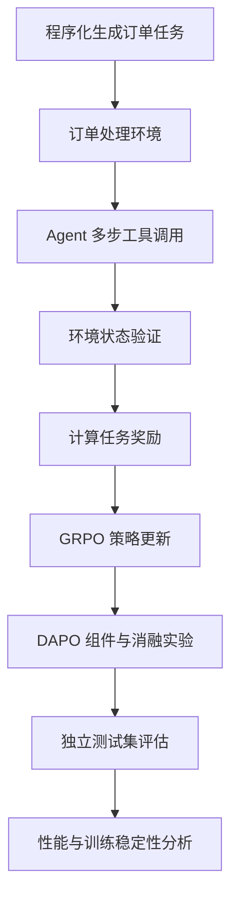

# 基于 TRL 与 GRPO 的订单处理 Agent 强化学习训练及 DAPO 跨域消融验证

<p align="center">
  
  
  
  
</p>

## 项目简介

本项目面向多步工具调用场景下的任务执行与业务规则遵守问题，基于 PyTorch、Transformers 和 TRL 搭建订单处理 Agent 强化学习训练流程。

项目以 Qwen2.5-0.5B-Instruct 为基础模型，构建包含订单查询、库存查询、订单修改和结果验证的交互环境，通过环境反馈评估 Agent 的任务执行效果，并使用 GRPO（Group Relative Policy Optimization）进行策略优化。

在标准 GRPO 的基础上，项目引入 DAPO 的多个训练机制，开展单组件消融与完整配置对照实验，分析不同训练策略对模型任务执行能力及训练稳定性的影响。

项目主要研究以下问题：

- 如何构建能够验证真实业务状态的多步工具调用环境？
- 如何利用强化学习提升 Agent 的任务执行能力和业务规则遵守能力？
- DAPO 的不同训练组件对 Agent 的任务执行效果有何影响？
- 训练过程中的奖励、策略熵和零方差样本组比例，如何反映模型的训练状态？

## 项目成果

在订单处理 Agent 多步工具调用任务上，基于固定测试集开展 GRPO 与 DAPO 对照实验，评估不同训练配置对任务执行成功率、候选轨迹成功覆盖能力及分场景表现的影响。

主要实验结果：

- 完整 DAPO 相较 Vanilla GRPO，greedy success@1 从 16.0% 提升至 22.0%，提升 6.0 个百分点。
- 在 100 条测试任务上，完整 DAPO 的 pass@8 从 41.0% 提升至 43.0%，提升 2.0 个百分点。
- 单独引入 Dynamic Sampling 后，greedy success@1 达到 29.0%，高于完整 DAPO 的 22.0%，但 pass@8 与完整 DAPO 持平，均为 43.0%。
- 分场景评估显示，完整 DAPO 在 combined 场景下的 pass@8 从 66.7% 提升至 83.3%，但在 insufficient_stock 场景下从 7.1% 降至 0%，说明不同训练配置对不同任务场景的影响存在差异。
- 通过训练奖励、策略熵、零方差样本组比例及独立测试集评估，分析不同训练组件对模型任务执行能力和训练稳定性的影响。

实验结果表明，DAPO 组件的收益并非简单叠加。单独引入 Dynamic Sampling 在当前实验中取得了更高的 greedy success@1，而完整 DAPO 在多个场景上的表现存在不同程度的改善或退化。

## 技术栈

Python、PyTorch、Transformers、TRL、PEFT、LoRA、vLLM、GRPO、DAPO、Qwen2.5-0.5B-Instruct、pytest

## 1. 整体技术方案

项目采用“任务生成—环境交互—奖励计算—策略优化—独立评估”的训练流程。



训练过程中，模型根据订单任务生成工具调用轨迹，环境执行工具操作并维护订单状态。奖励函数依据环境最终状态、业务规则遵守情况及工具调用行为进行计算，再由 GRPO 根据同组候选轨迹的相对奖励更新策略。

## 2. 订单处理环境

### 2.1 工具调用设计

基于程序化生成方法构建订单处理任务，通过独立的环境状态管理和工具执行逻辑模拟真实业务流程。

环境提供以下工具：

| 工具 | 功能 |
|---|---|
| `query_order` | 查询订单信息及当前状态 |
| `query_stock` | 查询商品库存 |
| `modify_order` | 修改订单信息 |
| `verify_order` | 验证订单最终状态 |

Agent 需要根据任务要求，结合工具返回的信息，决定下一步操作，并在必要时进行结果验证。

### 2.2 业务规则与任务场景

任务覆盖六类场景：

1. 正常订单修改：查询订单与库存后，完成合法的订单修改。
2. 已发货拒改：订单已发货时，拒绝执行不符合业务规则的修改。
3. 库存不足：目标商品库存不足时，避免执行非法订单变更。
4. 非法参数：识别无效订单参数或不符合接口要求的工具调用。
5. 异常恢复：工具调用失败后，根据环境返回的信息调整后续执行策略。
6. 多步工具调用：完成需要连续查询、判断、修改和验证的组合任务。

### 2.3 环境状态验证

项目以环境实际执行结果作为任务完成的判断依据，而不是仅根据模型生成的自然语言判断任务是否成功。

例如，模型即使在最终回答中声称“订单修改成功”，如果环境中的订单状态没有发生预期变化，也不能获得任务成功奖励。

通过环境状态验证，避免模型仅通过生成看似正确的回答获得高奖励，促使其学习真正可执行的工具调用策略。

## 3. 训练数据构建

使用种子驱动的程序化生成方法构建训练数据和独立测试数据。

| 数据集 | 规模 | 用途 |
|---|---:|---|
| 训练集 | 3000 条 | GRPO 训练及策略优化 |
| 独立测试集 | 1000 条 | 训练完成后的性能评估 |

数据生成与校验流程包括：

- 根据任务场景和业务规则生成订单任务。
- 使用固定随机种子控制数据生成过程。
- 对生成任务进行合法性和可执行性校验。
- 将训练任务与测试任务分别保存，避免训练和评估使用相同任务。
- 在固定测试集上对不同训练配置进行对照评估。

训练集与测试集保持独立，测试集不参与模型参数更新。

## 4. 模型训练与奖励设计

### 4.1 基础模型与训练流程

基础模型采用 `Qwen/Qwen2.5-0.5B-Instruct`，使用 LoRA 降低训练所需的显存和计算开销。

训练流程基于 TRL 的 `GRPOTrainer` 扩展实现，主要包括：

1. 加载订单任务和基础模型。
2. 为每条任务生成多个候选工具调用轨迹。
3. 在独立环境中执行候选轨迹并计算奖励。
4. 根据同组候选轨迹的相对奖励计算策略优势。
5. 使用 GRPO 更新模型参数。
6. 保存训练结果并在固定测试集上评估。

### 4.2 冷启动 SFT

由于基础模型在多步工具调用场景下可能无法稳定输出符合协议要求的工具调用，项目先使用确定性 Oracle 轨迹构造冷启动数据，进行监督微调。

冷启动 SFT 的主要作用是帮助模型学习工具调用格式和基本执行模式，为后续强化学习提供有效的初始策略。

随后使用 GRPO 优化模型的任务执行能力，而不是仅依靠监督微调学习固定的工具调用模板。

### 4.3 奖励设计

奖励函数围绕任务完成、业务规则遵守和工具调用行为设计，主要包含以下因素：

| 奖励因素 | 评价目标 |
|---|---|
| 任务成功 | 订单最终状态是否符合任务要求 |
| 规则遵守 | 是否违反订单业务约束 |
| 结果验证 | 是否正确验证订单修改结果 |
| 非法操作惩罚 | 是否产生不合法或不允许的工具操作 |
| 冗余调用惩罚 | 是否存在不必要的工具调用 |
| 调用成本 | 控制多步工具调用带来的执行开销 |
| 进度奖励 | 对有效的任务执行过程提供反馈 |

奖励计算以环境实际执行结果为依据，而不是仅根据模型生成的自然语言判断任务是否成功。

同时，通过格式奖励对工具调用协议的合法性进行评价，帮助模型学习稳定、可执行的工具调用格式。

## 5. DAPO 组件与消融实验

项目在 Vanilla GRPO 基础上引入 DAPO 的多个训练机制，通过单组件实验和完整配置对比，分析不同组件对任务执行效果及训练稳定性的影响。

### 5.1 Dynamic Sampling

Dynamic Sampling 用于缓解强化学习训练中同组候选轨迹奖励缺乏差异的问题。

当同组候选轨迹获得相同奖励时，GRPO 难以从组内相对优势中获得有效的策略更新信号。

项目通过对候选轨迹的奖励分布进行分析，研究动态采样机制对有效训练样本比例和模型性能的影响。

### 5.2 Clip-Higher

Clip-Higher 通过调整策略更新中的裁剪范围，改善标准 GRPO 对策略概率比值的约束方式。

项目将其作为独立训练组件进行对照，分析其对模型策略更新和最终任务成功率的影响。

### 5.3 Token-level Loss

Token-level Loss 从 token 粒度计算策略优化损失，研究不同损失计算方式对长序列、多步工具调用任务的影响。

### 5.4 Overlong Reward Shaping

Overlong Reward Shaping 用于处理过长生成序列带来的训练问题。

项目通过对生成长度和奖励进行联合分析，研究长度约束机制对多步工具调用任务的影响。

### 5.5 实验对照组

实验设置 Vanilla GRPO、单组件改进及完整 DAPO 等对照配置。

| 实验配置 | 目的 |
|---|---|
| Vanilla GRPO | 建立标准 GRPO 基线 |
| GRPO + Dynamic Sampling | 验证动态采样机制的独立作用 |
| GRPO + Clip-Higher | 验证裁剪机制的独立作用 |
| GRPO + Token-level Loss | 验证 token 级损失的独立作用 |
| GRPO + Overlong Reward Shaping | 验证长度奖励机制的独立作用 |
| 完整 DAPO | 评估多个组件联合使用的效果 |

各实验配置使用相同的独立测试集进行评估，结合训练过程指标分析不同组件的实际收益。

## 6. 实验结果与分析

### 6.1 评估指标

项目使用以下指标评价模型的任务执行能力：

| 指标 | 定义 |
|---|---|
| greedy success@1 | 每条任务使用一次确定性生成，统计环境最终状态验证成功的任务比例 |
| pass@8 | 每条任务采样 8 次，统计至少存在一次成功执行的任务比例 |
| per-rollout | 所有采样执行轨迹中，成功轨迹占全部执行轨迹的比例 |

其中，pass@8 衡量模型在多次尝试下完成任务的能力，per-rollout 衡量单次采样执行的平均成功率，greedy success@1 衡量模型在确定性生成条件下的任务执行能力。

### 6.2 不同训练配置的总体表现

在 100 条测试任务上进行 8 次采样评估，对 Vanilla GRPO、DAPO 单组件配置及完整 DAPO 进行对照。

| 实验配置 | pass@8 | per-rollout | greedy success@1 |
|---|---:|---:|---:|
| Vanilla GRPO | 0.410 | 0.179 | 0.160 |
| + Dynamic Sampling | 0.430 | 0.214 | 0.290 |
| + Clip-Higher | 0.400 | 0.144 | 0.100 |
| + Overlong Reward Shaping | 0.360 | 0.144 | 0.150 |
| + Token-level Loss | 0.350 | 0.181 | 0.240 |
| 完整 DAPO | 0.430 | 0.205 | 0.220 |

完整 DAPO 相较 Vanilla GRPO：

- pass@8 从 0.410 提升至 0.430，提升 2.0 个百分点。
- per-rollout 从 0.179 提升至 0.205，提升 2.6 个百分点。
- greedy success@1 从 0.160 提升至 0.220，提升 6.0 个百分点。

完整 DAPO 在三项指标上均高于 Vanilla GRPO，说明其在当前订单处理任务中改善了确定性执行效果和多次采样下的任务成功表现。

单组件消融实验中，Dynamic Sampling 的 greedy success@1 达到 0.290，高于完整 DAPO 的 0.220；其 pass@8 与完整 DAPO 持平，均为 0.430。

这说明 Dynamic Sampling 在当前实验中对确定性策略执行具有较强的独立收益，但完整 DAPO 与 Dynamic Sampling 的多次采样成功覆盖能力相近。不同训练组件的收益并不一定具有简单的叠加关系。

### 6.3 分场景评估

进一步按照任务场景统计 Vanilla GRPO 与完整 DAPO 的 pass@8，分析不同训练配置在各类订单处理任务上的表现。

| 场景 | Vanilla GRPO | 完整 DAPO | 变化 |
|---|---:|---:|---:|
| combined | 0.667 | 0.833 | +16.7 个百分点 |
| shipped | 0.733 | 0.800 | +6.7 个百分点 |
| invalid_order | 1.000 | 1.000 | 0 |
| insufficient_stock | 0.071 | 0.000 | -7.1 个百分点 |
| normal | 0.000 | 0.000 | 0 |
| transient_failure | 0.000 | 0.000 | 0 |

分场景结果显示：

- **combined 场景**：完整 DAPO 的 pass@8 从 0.667 提升至 0.833，提升 16.7 个百分点，是当前分场景评估中提升最明显的场景。
- **shipped 场景**：完整 DAPO 从 0.733 提升至 0.800，说明模型在已发货订单的业务规则处理上取得一定改善。
- **invalid_order 场景**：两种配置均达到 1.000，表明当前测试集中的非法订单参数任务已被较好解决。
- **insufficient_stock 场景**：完整 DAPO 从 0.071 降至 0.000，表明库存不足场景仍然存在明显的任务执行问题。
- **normal 和 transient_failure 场景**：两种配置均为 0.000，说明当前模型在这两类任务上的执行能力仍有较大提升空间。

分场景结果表明，整体指标提升并不意味着所有场景均得到改善。特别是库存不足、正常订单修改和异常恢复任务，仍需要进一步分析模型的工具调用轨迹、环境反馈和奖励设计。

### 6.4 训练稳定性分析

除最终任务成功率外，项目还监控以下训练过程指标：

| 指标 | 关注问题 |
|---|---|
| Training Reward | 训练奖励是否改善 |
| Policy Entropy | 策略探索程度及变化趋势 |
| Zero-variance Group Ratio | 同组候选轨迹奖励完全相同的比例 |
| Gate Pass | 训练过程中任务执行与评估门槛的通过情况 |
| Success@1 / Pass@8 | 最终任务执行效果 |

通过对训练奖励、策略熵及零方差样本组比例进行联合分析，研究不同训练机制是否改善了有效训练信号，以及这些变化是否最终反映到独立测试集的任务执行效果上。

### 6.5 实验结论

当前实验结果表明：

1. 完整 DAPO 相较 Vanilla GRPO，在总体 greedy success@1、pass@8 和 per-rollout 指标上均取得提升。
2. Dynamic Sampling 单独使用时取得了最高的 greedy success@1，但其 pass@8 与完整 DAPO 相同。
3. 不同 DAPO 组件的独立收益存在差异，组件组合后的效果并非简单叠加。
4. 分场景评估揭示了总体成功率无法体现的局部退化，尤其是 insufficient_stock、normal 和 transient_failure 场景。

因此，项目不仅评估强化学习训练后模型的总体任务执行效果，也通过单组件消融和分场景评估分析不同训练机制的实际作用及其局限性。

## 7. 项目结构

```text
grpo/
├── configs/                  # 模型、训练、奖励和路径配置
├── data/
│   └── generated/            # 程序化生成的训练、验证和测试数据
├── docs/                     # 项目实现与实验文档
├── evaluation/               # 固定测试集评估与指标计算
├── grpo_agent/               # 订单环境、Agent、奖励及 DAPO 实现
├── logs/                     # 训练轨迹和评估输出
├── scripts/                  # 数据生成与测试脚本
├── tests/                    # 单元测试
├── training/                 # 冷启动 SFT 与 GRPO 训练入口
├── requirements.txt          # 训练环境依赖
├── requirements-aistudio.txt # AI Studio 环境依赖
└── README.md
```

## 8. 环境配置

### 8.1 环境要求

- Python 3.10+
- PyTorch
- Transformers
- TRL
- PEFT
- Accelerate
- Datasets
- PyYAML

模型训练需要支持 PyTorch 的 GPU 环境。订单环境、任务生成和基础单元测试不依赖 GPU 或外部大模型 API。

### 8.2 安装依赖

克隆仓库：

```bash
git clone https://github.com/hhhdear/grpo.git
cd grpo
```

创建虚拟环境：

```bash
python -m venv .venv
```

Windows：

```powershell
.venv\Scripts\Activate.ps1
```

Linux：

```bash
source .venv/bin/activate
```

安装依赖：

```bash
python -m pip install -r requirements.txt
```

对于百度 AI Studio 等已经提供 CUDA 环境的 GPU 平台，可根据实际环境使用：

```bash
python -m pip install -r requirements-aistudio.txt
```

安装后检查 PyTorch 和 CUDA：

```bash
python -c "import torch; print(torch.__version__, torch.version.cuda, torch.cuda.is_available())"
```

## 9. 运行流程

以下命令均在项目根目录执行。

### 9.1 生成任务数据

```bash
python scripts/generate_data.py --config configs/baseline.yaml
```

### 9.2 运行单元测试

```bash
python -m unittest discover -s tests -v
```

### 9.3 运行环境冒烟测试

```bash
python scripts/smoke_test.py --config configs/baseline.yaml
```

### 9.4 冷启动 SFT

先检查训练参数：

```bash
python training/sft_coldstart.py --config configs/baseline.yaml --dry-run
```

执行冷启动训练：

```bash
python training/sft_coldstart.py --config configs/baseline.yaml
```

训练完成后，使用实际生成的冷启动模型目录作为后续 GRPO 的模型路径。

### 9.5 GRPO 训练

```bash
python training/train_grpo.py --config configs/baseline.yaml --dry-run
```

执行训练：

```bash
python training/train_grpo.py --config configs/baseline.yaml
```

训练输出目录由 `configs/baseline.yaml` 中的配置决定。

### 9.6 训练后评估

```bash
python evaluation/evaluate.py \
    --config configs/baseline.yaml \
    --policy model
```

也可以使用 Oracle 策略检查环境和评估管线：

```bash
python evaluation/evaluate.py \
    --config configs/baseline.yaml \
    --policy oracle
```

上述命令用于复现基础训练和评估流程。正式实验中的训练步数、模型路径、随机种子及其他超参数，应以对应实验配置为准。

## 10. 结果与实验记录

项目将训练过程、评估轨迹和最终指标分别保存，便于检查训练行为及复现实验结果。

主要产物包括：

- 模型或 LoRA adapter checkpoint。
- 训练运行清单 `run_manifest.json`。
- 评估轨迹 JSONL。
- 评估指标 JSON。
- 训练奖励、策略熵和零方差样本组比例等过程指标。

实验分析以固定独立测试集上的环境状态成功率为核心指标，同时结合训练过程指标解释不同训练配置的表现差异。

## 11. 后续工作

- 进一步分析 Dynamic Sampling 与其他 DAPO 组件之间的作用关系。
- 研究不同训练超参数对多步工具调用任务的影响。
- 在更多任务场景和随机种子下验证实验结果的稳定性。
- 探索不同规模模型在订单处理 Agent 场景下的强化学习训练效果。

## 12. 参考资料

- [TRL](https://github.com/huggingface/trl)
- [Transformers](https://github.com/huggingface/transformers)
- [Qwen2.5](https://github.com/QwenLM/Qwen2.5)
- [DAPO: An Open-Source LLM Reinforcement Learning System at Scale](https://arxiv.org/abs/2503.14476)
